# MikołajRej

### Od skanu archiwalnego do czytelnego tekstu.

[English](README.md) · **Polski**

Przeglądaj historyczne rękopisy w lokalnej aplikacji webowej. Wybierz skany, podziel stronę na wiersze, rozpoznaj tekst i sprawdź odczyt bezpośrednio przy oryginalnym obrazie.

**[Pobierz model i Diariusz LM](https://huggingface.co/lukaszrzepinski/MikolajRej/tree/main) · [Kod aplikacji](https://github.com/lukaszrzepinski-gmail/mikolaj-rej-ocr) · [Uruchomienie](docs/QUICKSTART.md)**

[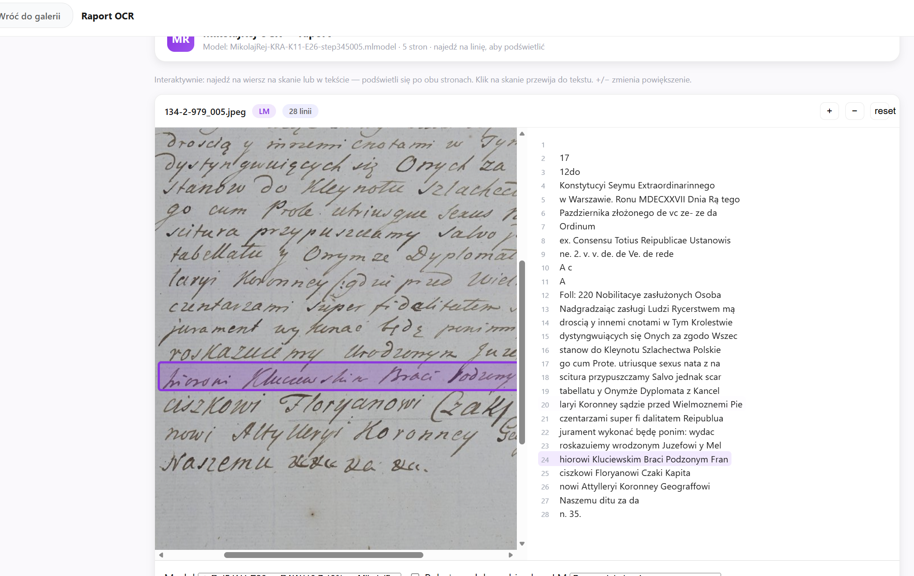](screenshots/app-reader.png)

*Rzeczywisty widok aplikacji: skan i tekst obok siebie, z powiązanym podświetlaniem wierszy.*

## Czytaj. Porównuj. Sprawdzaj.

- **Przeglądaj kolekcję** — galeria skanów, obrót i wybór wielu stron.
- **Zachowaj układ dokumentu** — segmentacja wierszy, kolumny i kolejność czytania.
- **Porównuj odczyty** — RAW, opcjonalny Diariusz LM i zapisane wersje modeli.
- **Pracuj przy źródle** — raport skan ↔ tekst, podświetlanie wierszy i ręczne poprawki.

## Zobacz działanie — 12 ekranów

Kliknij wybrany ekran, aby otworzyć go w pełnym rozmiarze. Galeria łączy przesłane widoki aplikacji z zapisanymi odczytami Diariusza i dawnych kodeksów.

| | |
|---|---|
| **01 · Widok aplikacji: skan i odczyt**  | **02 · Galeria skanów i zapisanych wyników** [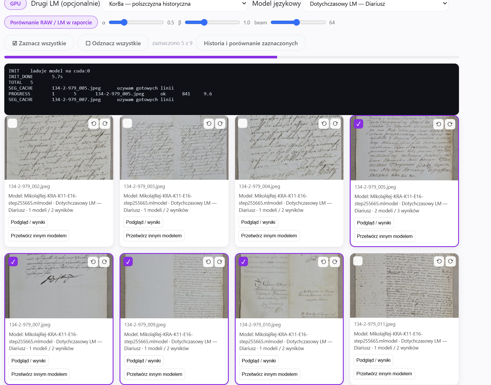](screenshots/app-gallery.png) |
| **03 · Księga archiwalna w aplikacji** [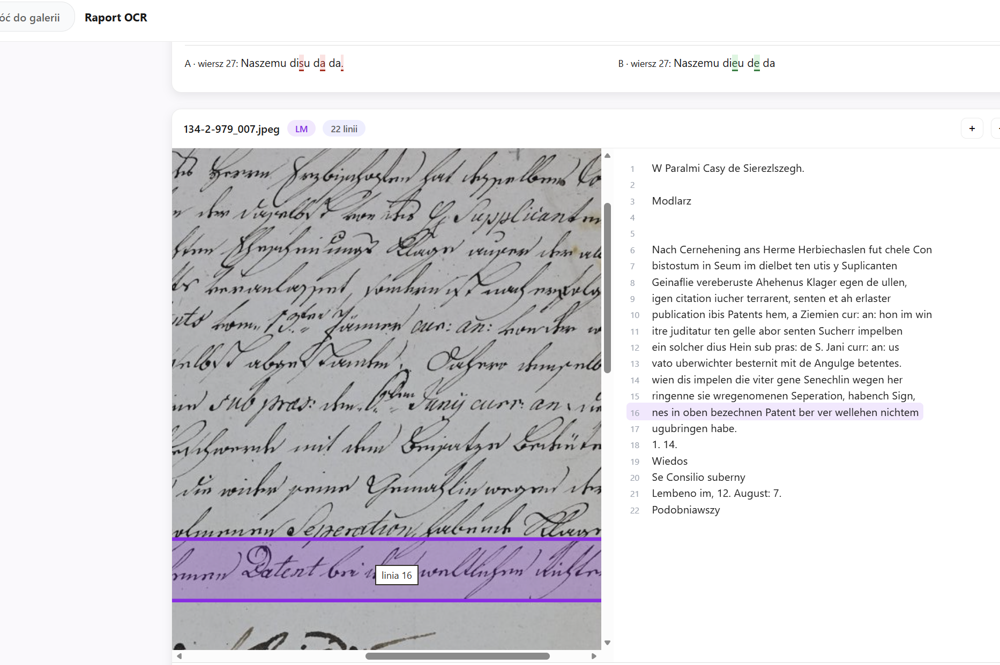](screenshots/app-register.png) | **04 · Diariusz Rybeńki · r01-R** [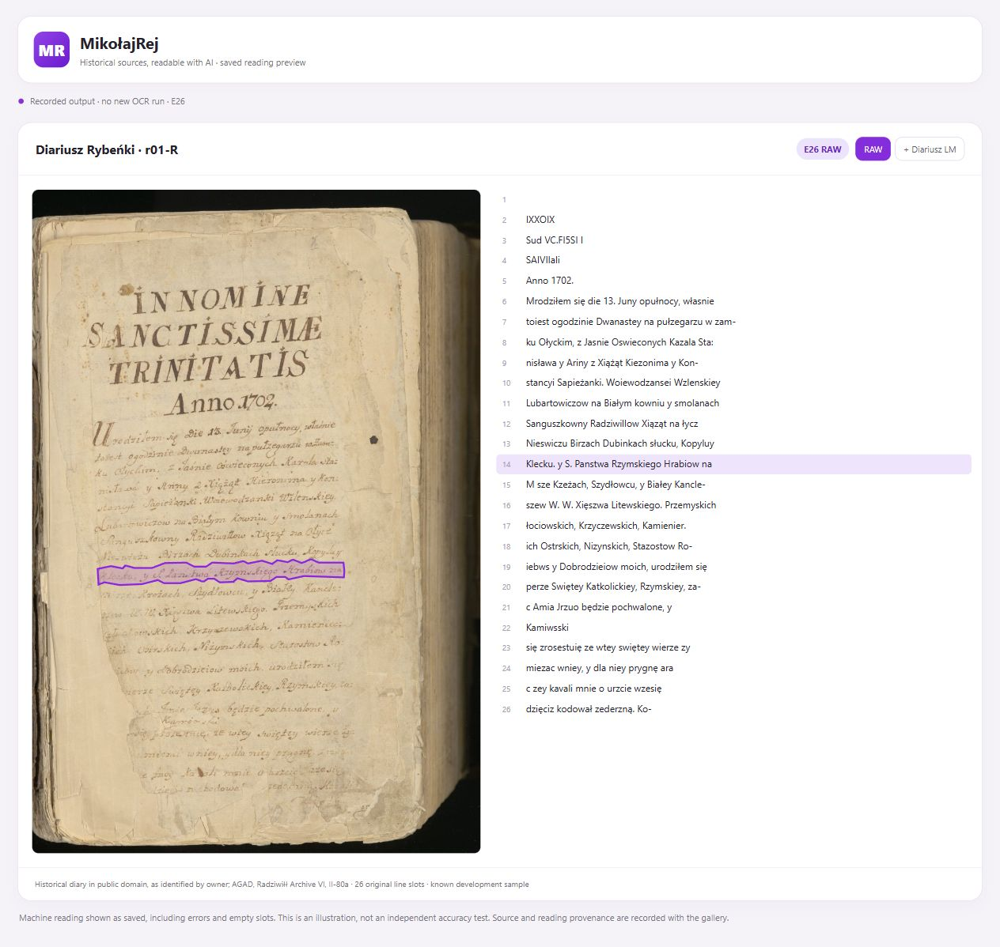](screenshots/reading-01.png) |
| **05 · Diariusz Rybeńki · r02-L** [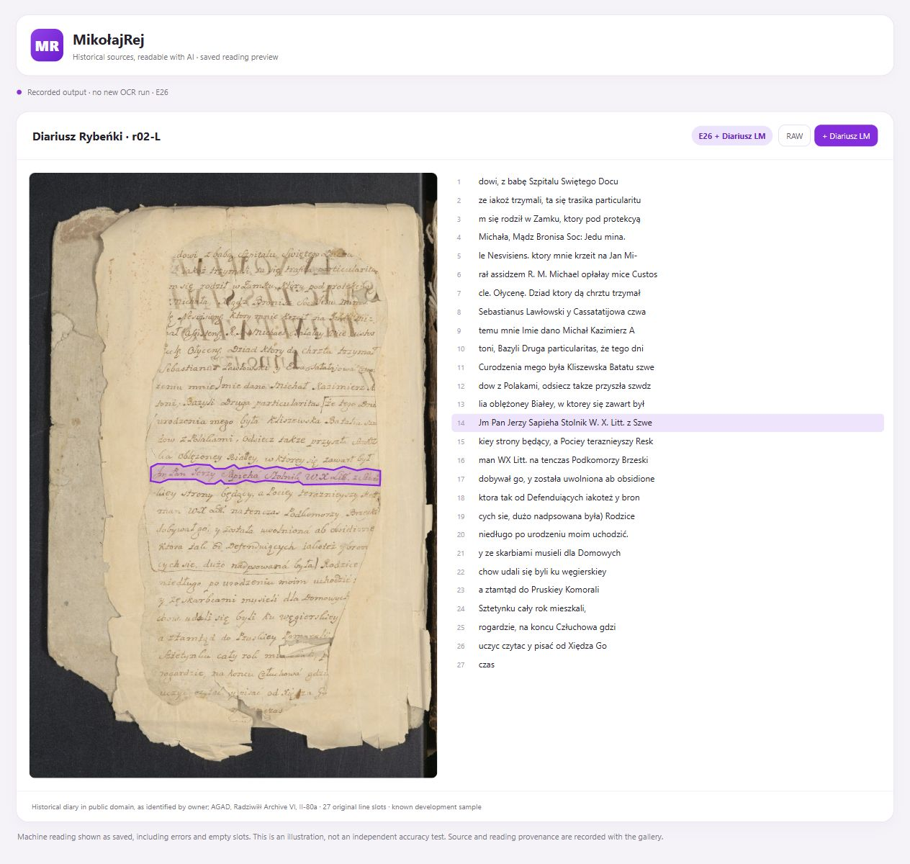](screenshots/reading-02.png) | **06 · Diariusz Rybeńki · r02-R** [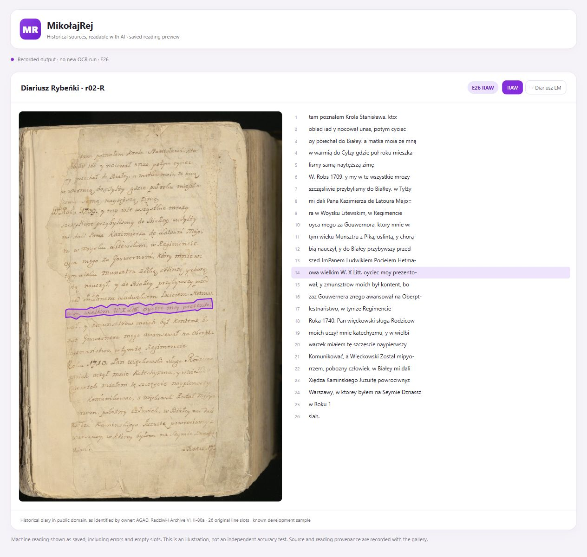](screenshots/reading-03.png) |
| **07 · Psałterz floriański · zapisany wiersz** [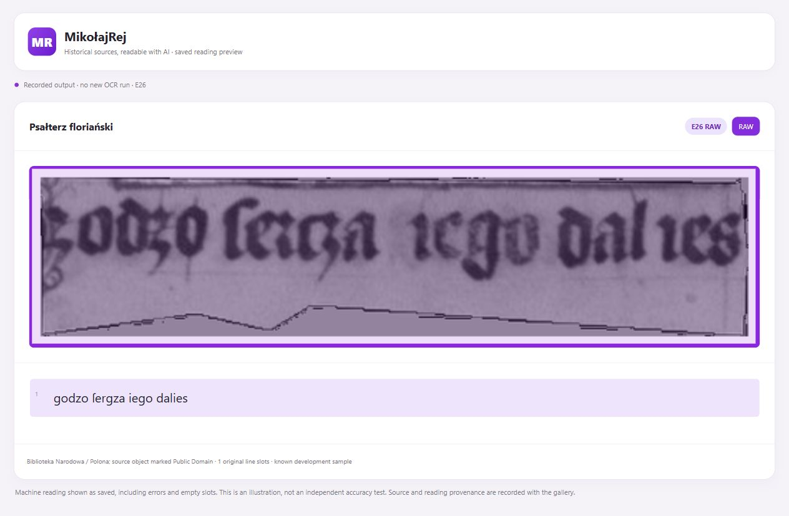](screenshots/reading-04.png) | **08 · Psałterz floriański · zapisany wiersz** [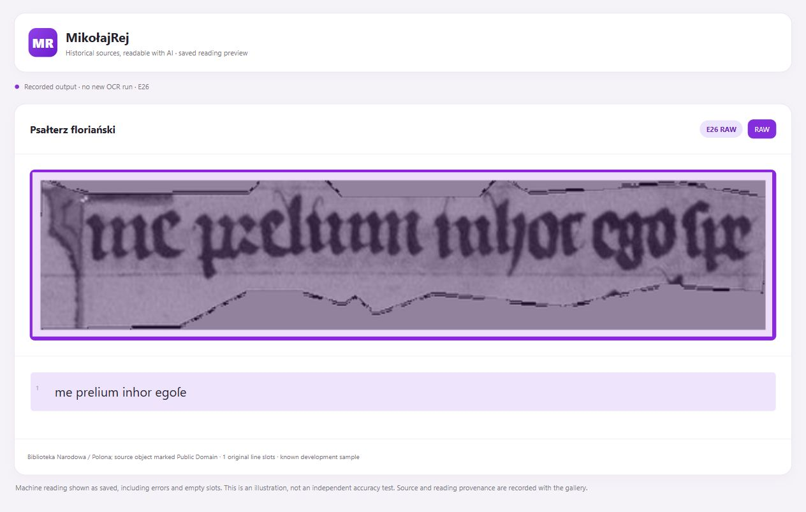](screenshots/reading-05.png) |
| **09 · Rozmyślanie przemyskie · zapisany wiersz** [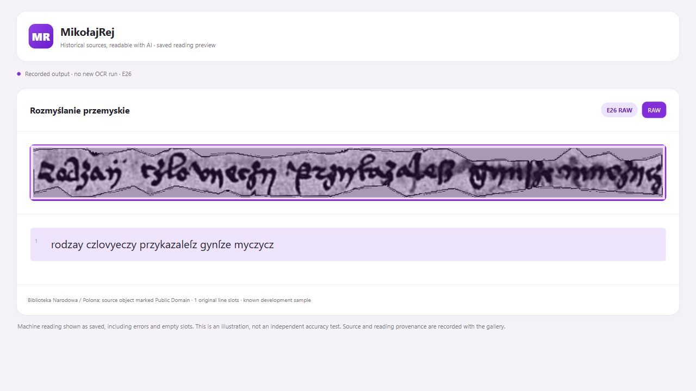](screenshots/reading-06.png) | **10 · Rozmyślanie przemyskie · zapisany wiersz** [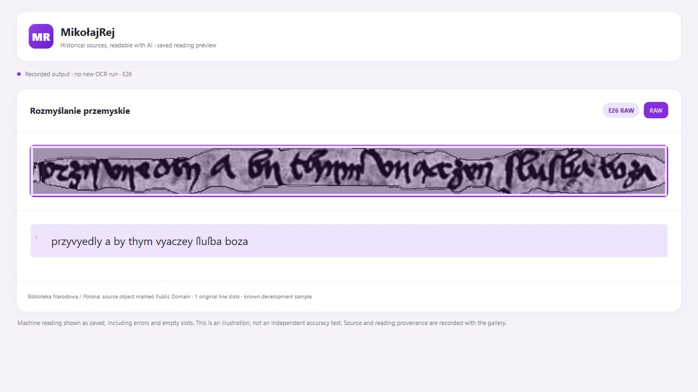](screenshots/reading-07.png) |
| **11 · Ortyle prawa magdeburskiego · zapisany wiersz** [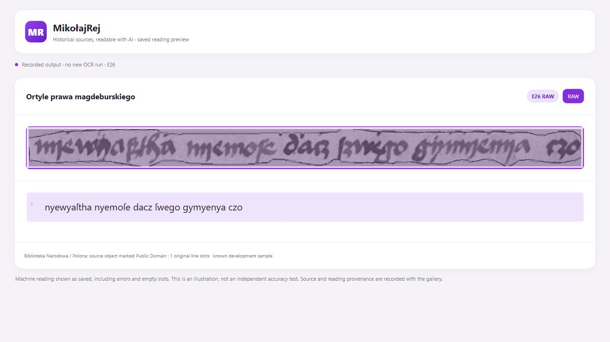](screenshots/reading-08.png) | **12 · Ortyle prawa magdeburskiego · zapisany wiersz** [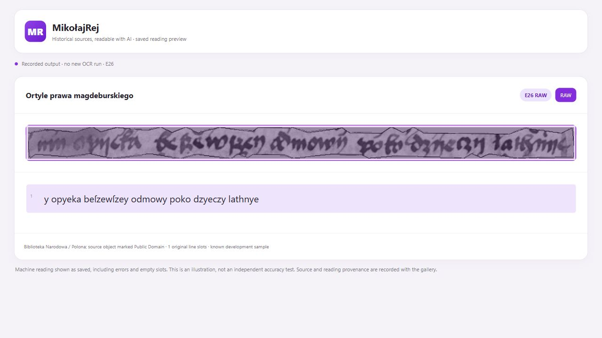](screenshots/reading-09.png) |

*Zapisane wyniki, również z błędami. Oryginalne widoki aplikacji mogą pokazywać wcześniejsze wersje. Podglądy E26 pochodzą ze znanych próbek DEV, nie z niezależnego testu. [Źródła i pochodzenie odczytów](screenshots/README.md).*

## Uruchom u siebie

Pobierz [kod aplikacji](https://github.com/lukaszrzepinski-gmail/mikolaj-rej-ocr) oraz [model i LM](https://huggingface.co/lukaszrzepinski/MikolajRej/tree/main). Pełna aplikacja jest przeznaczona dla Windows / Python 3.12 i domyślnie używa CPU. [Angielska instrukcja uruchomienia](docs/QUICKSTART.md) opisuje instalację i pipeline. To oprogramowanie do lokalnej pracy, a nie publiczny serwer wykonujący OCR.

## Badania i projekty publiczne

Niekomercyjne badania naukowe i projekty realizowane w interesie publicznym są dozwolone **z atrybucją Łukasza Rzepińskiego** i zachowaniem warunków licencji. Autorowi będzie miło, jeśli dasz znać, do czego wykorzystujesz projekt; wiadomość jest dobrowolna.

**Komercyjne wykorzystanie praw objętych licencją wymaga kontaktu i odrębnej pisemnej zgody:** [lukasz.rzepinski@gmail.com](mailto:lukasz.rzepinski@gmail.com). To własne warunki, **nie MIT**; prawa upstream i domena publiczna pozostają zachowane. [Warunki](LICENSE) · [Wersja angielska](LICENSE.en.md).

## Projekt i autor

[zbiorycyfrowe.pl](https://zbiorycyfrowe.pl/) to projekt przetwarzania zasobów archiwalnych przy użyciu sztucznej inteligencji. MikołajRej wspiera rozpoznawanie i opracowanie tekstu historycznych dokumentów.

**Łukasz Rzepiński** jest Solution Architectem pracującym w branży badań klinicznych. Wcześniej pracował w bankowości i telekomunikacji. Jest autorem serwisów [ofertarium.pl](https://ofertarium.pl/), [lekoskop.pl](https://lekoskop.pl/), [ostint.pl](https://ostint.pl/) i [zrodlacyfrowe.pl](https://zrodlacyfrowe.pl/).

Kontakt: [lukasz.rzepinski@gmail.com](mailto:lukasz.rzepinski@gmail.com).

## Dokumentacja

[Pełna model card i pochodzenie](docs/MODEL_CARD.pl.md) · [Wyniki i ograniczenia](docs/EVALUATION.md) · [Autorstwo i prawa źródeł](NOTICE.md) · [Sumy kontrolne](SHA256SUMS).

Nazwiska, daty i cyfry nadal wymagają kontroli człowieka. Szczegółowa dokumentacja zachowuje ograniczenia DEV, pochodzenia i zakresu sprawdzenia środowiska; zrzuty są ilustracją, nie nowym benchmarkiem.
