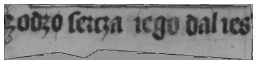
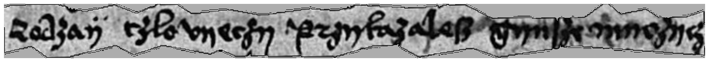
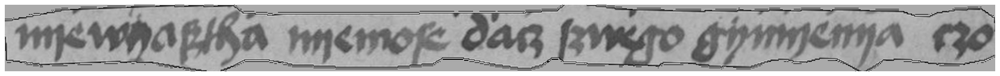

# Przykłady skan → zapisany RAW E26

Znane próbki pseudo DEV, bez referencji. Nie są dowodem jakości na nieznanych źródłach. Wybrano pierwszy identyfikator w każdej z trzech domen, bez selekcji według jakości.

## Psałterz

Odczyt RAW: `godzo ſergza iego dalies`

Źródło: Biblioteka Narodowa / Polona, karta 31r; [manifest](https://polona.pl/api/search-service/search/iiif/2f1c8624-a5cc-45e2-861d-29269f2146da/manifest.json). Skan oznaczony domeną publiczną. Geometria i hash w examples.json.

## Rozmyślanie

Odczyt RAW: `rodzay czlovyeczy przykazaleſz gynſze myczycz`

Źródło: Biblioteka Narodowa / Polona, karta 4-5; [manifest](https://polona.pl/api/search-service/search/iiif/8ca61357-7fcb-4dfd-96bf-1be820f90eba/manifest.json). Skan oznaczony domeną publiczną. Geometria i hash w examples.json.

## Ortyle

Odczyt RAW: `nyewyaſtha nyemoſe dacz ſwego gymyenya czo`

Źródło: Biblioteka Narodowa / Polona, karta 21v-22r; [manifest](https://polona.pl/api/search-service/search/iiif/58a8443d-0959-4613-8554-d4d01429f833/manifest.json). Skan oznaczony domeną publiczną. Geometria i hash w examples.json.
